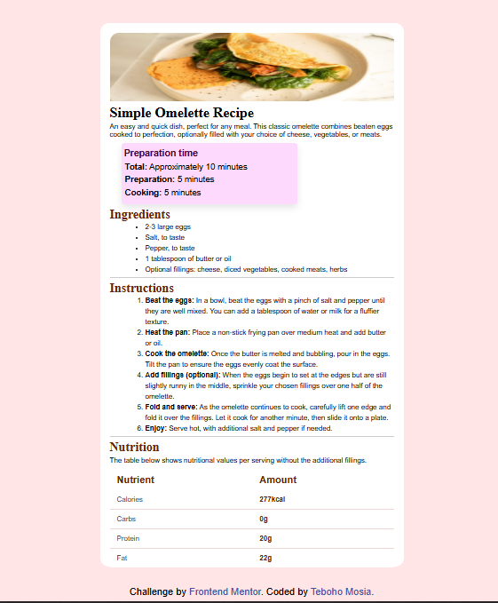

# Frontend Mentor - Recipe page solution

This is a solution to the [Recipe page challenge on Frontend Mentor](https://www.frontendmentor.io/challenges/recipe-page-KiTsR8QQKm). Frontend Mentor challenges help you improve your coding skills by building realistic projects. 

## Table of contents

- [Overview](#overview)
  - [The challenge](#the-challenge)
  - [Screenshot](#screenshot)
  - [Links](#links)
- [My process](#my-process)
  - [Built with](#built-with)
  - [What I learned](#what-i-learned)
  - [Continued development](#continued-development)
  - [Useful resources](#useful-resources)
  - [AI Collaboration](#ai-collaboration)
- [Author](#author)
- [Acknowledgments](#acknowledgments)

## Overview

### Screenshot

### Links

- Solution URL: [Frontend Mentor](https://your-solution-url.com)
- Live Site URL: [GitHub](https://master-teb.github.io/recipe-page-main/)

## My process

### Built with

- Semantic HTML5 markup
- CSS custom properties
- Flexbox

### What I learned

to size proportionally (working progress). 

### Continued development

try mobile-first approach.

### Useful resources

- the "design" image was a great help.

### AI Collaboration

- i used GitHub Copilot to work on this project.
- i used it to check my work, e.g, best elements/css properties to use

## Author

- GitHub - [master-teb](https://github.com/master-teb)
- Frontend Mentor - [@master-teb](https://www.frontendmentor.io/profile/master-teb)
- Instagram - [@webmasterteb](https://www.instagram.com/webmasterteb/)

## Acknowledgments

- thanks to Frontend Mentor for the challenge.
- thank you to the community for the feedback.
- thank you to me for completing the challenge.
